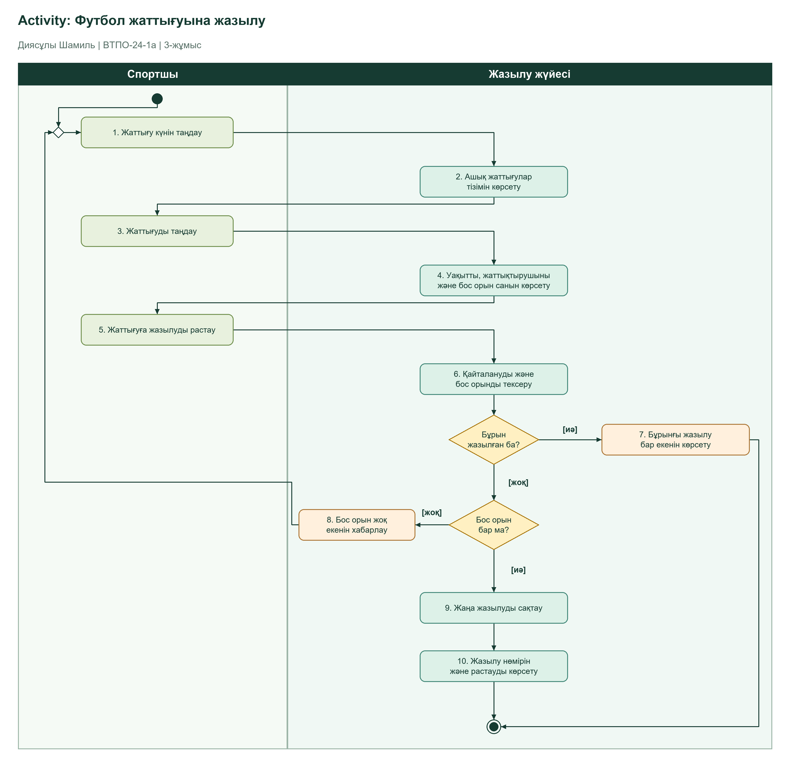
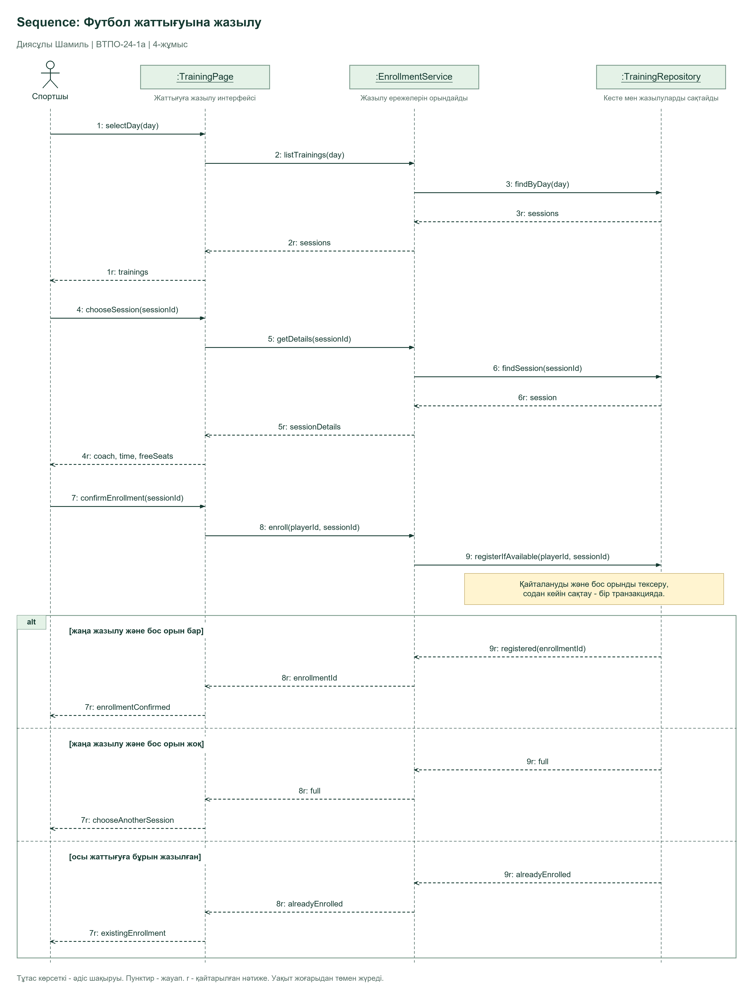

# Футбол жаттығуларына жазылу жүйесі

Автор: **Диясұлы Шамиль**, **ВТПО-24-1а**  
GitHub: [ShomaNey](https://github.com/ShomaNey)

## Мәселе

Футбол жаттығуларына қатысушыларды хабарламалар арқылы қолмен тіркеу жаттықтырушыға қосымша жұмыс туғызады. Спортшы жаттығу уақытын, жаттықтырушыны және бос орын санын бір жерден көре алуы керек. Жоба кестені қарап, қолайлы жаттығуға жазылуға және қайталанатын жазылуларды болдырмауға арналған.

## Акторлар

- **Спортшы**: кестені қарайды, жаттығуды таңдайды және қатысуын растайды.
- **Жаттықтырушы**: жаттығу уақытын, қатысушылар шегін және қатысушылар тізімін басқарады.

## Талаптар

### Функционалдық

1. Жүйе таңдалған күндегі ашық жаттығуларды көрсетуі керек.
2. Жүйе әр жаттығудың уақытын, жаттықтырушысын және бос орын санын көрсетуі керек.
3. Жүйе тіркелген спортшыны таңдалған жаттығуға жаза алуы керек.
4. Жүйе бір спортшыны бір жаттығуға бірнеше рет жазбауы керек.
5. Жүйе қатысушылар санының белгіленген шектен асуына жол бермеуі керек.
6. Жүйе жазылу нәтижесін және бос орын болмағандағы хабарламаны көрсетуі керек.

### Функционалдық емес

1. Спортшы мен жаттықтырушының қолжетімділік құқықтары бөлек болуы керек.
2. Жазылу деректері дерекқорда сақталуы керек.
3. Бос орын мен қайталануды тексеру және жаңа жазылуды сақтау бір транзакцияда орындалуы керек.

Бұл - болашақ жүйенің жобалық талаптары. Қолданба коды кейін `src/` қалтасына қосылады.

## Диаграммалар

### 1. Use Case

Кейін қосылады: `docs/diagrams/01-usecase.drawio` және `01-usecase.png`.

### 2. Class

Кейін қосылады: `docs/diagrams/02-class.drawio` және `02-class.png`.

### 3. Activity: Футбол жаттығуына жазылу

**Прецедент:** спортшының футбол жаттығуына жазылуы. Бұл - 4-жұмыстағы Sequence диаграммасымен бірдей прецедент.

**Алғышарт:** спортшы жүйеге кірген; жаттықтырушы жаттығу кестесін және қатысушылар шегін енгізген. Таңдалатын жаттығу ашық және кестеде бар.



[Өңделетін draw.io файлы](docs/diagrams/03-activity.drawio) · [PNG суреті](docs/diagrams/03-activity.png)

Диаграммада **Спортшы** және **Жазылу жүйесі** деген екі жауапкершілік жолы (swimlane), бастау және аяқтау белгілері, **10 әрекет** және **2 шешім ромбы** бар. Әр шешімнің шығыс жолдары `[иә]` және `[жоқ]` шарттарымен белгіленген. Сол жақтағы шағын ромб бастапқы жол мен қайталанатын таңдауды біріктіреді.

**Негізгі жол:** спортшы күнді және жаттығуды таңдайды; жүйе уақытты, жаттықтырушыны және бос орын санын көрсетеді. Спортшы жазылуды растағаннан кейін жүйе қайталануды және бос орынды қайта тексереді. Спортшы бұрын жазылмаған және орын бар болса, жаңа жазылу сақталып, оның нөмірі мен растау көрсетіледі.

**Балама жолдар:**

- Спортшы осы жаттығуға бұрын жазылған болса, жүйе бұрынғы жазылу бар екенін көрсетіп, процесті аяқтайды. Қайталанатын жазба жасалмайды.
- Спортшы бұрын жазылмаған, бірақ бос орын жоқ болса, жүйе хабарлама көрсетеді. Спортшы күнді және басқа жаттығуды қайта таңдайды.

Бастапқы тізімдегі бос орын саны растауға дейін өзгеруі мүмкін. Сондықтан 6-қадамдағы тексерулер мен 9-қадамдағы сақтау бір `registerIfAvailable(...)` операциясының логикалық бөліктері ретінде көрсетілген; жүйені іске асырғанда олар бір дерекқор транзакциясында орындалуы керек. Бұл 4-жұмыстағы `registered`, `full` және `alreadyEnrolled` нәтижелеріне сәйкес келеді.

### 4. Sequence: Футбол жаттығуына жазылу

**Прецедент:** спортшының футбол жаттығуына жазылуы.

**Алғышарт:** спортшы жүйеге кірген; жаттықтырушы жаттығу кестесі мен қатысушылар шегін енгізген. Таңдалатын жаттығу ашық және кестеде бар.



[Өңделетін draw.io файлы](docs/diagrams/04-sequence.drawio) · [PNG суреті](docs/diagrams/04-sequence.png)

Сол жақтағы актор - **Спортшы**. Одан кейін үш объект орналасқан:

| Объект | Міндеті |
| --- | --- |
| `:TrainingPage` | Спортшының таңдауын қабылдап, кесте мен нәтижені көрсету |
| `:EnrollmentService` | Жазылу сұрауларын өңдеп, интерфейс пен қойма арасындағы жұмысты ұйымдастыру |
| `:TrainingRepository` | Жаттығулар мен жазылуларды сақтау; орын мен қайталануды тексеру |

Уақыт жоғарыдан төмен қарай жүреді. Қатысушылардың тік пунктир сызықтары - өмір сызықтары. **Тұтас көрсеткілер** әдіс шақыруларын, **көлденең пунктир көрсеткілер** жауаптарды білдіреді. `3r` белгісі үшінші шақырудың қайтарылған нәтижесін көрсетеді; жауаптың атауы - қайтарылатын дерек.

Негізгі шақырулар әдіс түрінде жазылып, нөмірленген:

1. `selectDay(day)` - спортшы жаттығу күнін таңдайды.
2. `listTrainings(day)` - интерфейс жаттығулар тізімін сұрайды.
3. `findByDay(day)` - қойма таңдалған күндегі жаттығуларды қайтарады.
4. `chooseSession(sessionId)` - спортшы бір жаттығуды таңдайды.
5. `getDetails(sessionId)` - сервис жаттығу мәліметтерін сұрайды.
6. `findSession(sessionId)` - қойма жаттығуды және оның мәліметтерін береді.
7. `confirmEnrollment(sessionId)` - спортшы жазылуды растайды.
8. `enroll(playerId, sessionId)` - сервис спортшының жазылу сұрауын өңдейді.
9. `registerIfAvailable(playerId, sessionId)` - қойма қайталануды және бос орынды тексеріп, мүмкіндік болса жаңа жазылуды сақтайды.

Мұндағы `day` - күн, `sessionId` - жаттығу идентификаторы, `playerId` - жүйеге кірген спортшы идентификаторы, `enrollmentId` - сақталған жазылудың бірегей нөмірі.

**`alt` блогындағы өзара бөлек үш нәтиже:**

- `[жаңа жазылу және бос орын бар]`: жазылу сақталып, оның нөмірі интерфейс арқылы спортшыға көрсетіледі.
- `[жаңа жазылу және бос орын жоқ]`: жаңа жазылу сақталмайды; спортшыға басқа жаттығуды таңдау ұсынылады.
- `[осы жаттығуға бұрын жазылған]`: қайталанатын жазба жасалмайды; бұрынғы жазылу бар екені көрсетіледі.

`registerIfAvailable(...)` алдымен осы спортшының жазылуы бар-жоғын анықтайды. Жазылмаған болса, бос орынды тексеріп, жаңа жазылуды бір транзакцияда сақтайды. Жүйені іске асырғанда бір мезетте түскен сұраулар қатысушылар шегін асырып жібермеуі керек. Бұл әдістер жобалау үшін берілген; қолданба әлі іске асырылған жоқ.

## Репозиторий құрылымы

```text
diploma-football-training/
├── README.md
├── docs/
│   └── diagrams/
│       ├── 03-activity.drawio
│       ├── 03-activity.png
│       ├── 04-sequence.drawio
│       └── 04-sequence.png
└── src/
```

## Жұмыс күйі

- **4-жұмыс:** Sequence диаграммасы `.drawio` және `.png` форматтарында дайын.
- **3-жұмыс:** Activity диаграммасы `.drawio` және `.png` форматтарында дайын; жеке коммитпен қосылған.
- Use Case, Class және қолданба коды кейін қосылады.
